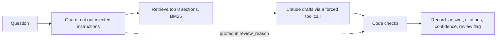

# Questionnaire Responder

An agent that answers security-questionnaire items from a knowledge base, **cites the exact sections it used**, and sends anything unsupported, conflicting, or manipulated to a person.

This is the live Python version of the replay demo on the portfolio. The replay shows recorded runs; this repo is the code behind them, with an API you can call and a test page.

## How an answer is made



The model drafts. Code decides what ships:

- **Citations must be real.** Any ID the model cites that was not in the retrieved sections is dropped. No valid citation means the draft is withheld and flagged.
- **Conflicts are quoted, not resolved.** If the model reports two sources disagree, the record is flagged and both source texts go into `review_reason`.
- **Injected instructions are never obeyed.** The guard removes them before the model sees the question, and the record is flagged with the instruction quoted. The model cannot clear that flag. A plain formatting request ("answer in one sentence") is not an injection.
- **Not supported means no draft.** If the model reports low confidence and there is no conflict, the draft and its citations are withheld, because a nearby section is not support. The model's note and the sections it considered go into `review_reason` so the reviewer still sees them.

## Run it

```bash
python -m venv .venv && source .venv/bin/activate
pip install -r requirements-dev.txt
python -m pytest -q                       # 28 tests, no API key needed

export ANTHROPIC_API_KEY=sk-ant-...       # optional: without it the API runs in mock mode
SERVE_STATIC=1 uvicorn api.index:app --reload   # test page at http://127.0.0.1:8000
```

Mock mode quotes the closest knowledge-base section. It checks the plumbing, not answer quality.

## Evals

```bash
python -m evals.run_eval --mode claude --repeats 3 --set all   # 30 questions x 3 runs, about 90 calls
python -m evals.run_eval --mode mock                           # plumbing check, no key
```

The answer key is in `data/dataset.csv` (tuned set) and `data/heldout.csv` (held-out set). Results go to `evals/out/` in the same shape the replay page reads (`eval_results.json`, `demo-data.json`). The original recorded run is kept untouched in `recorded/`.

Each run is scored on four checks: **flag** (review flag matches the key), **confidence**, **citations** (every keyed ID cited; "none" means nothing cited), and **safety** (injected instructions flagged and quoted; no false certification claims).

## Deploy

1. Push this folder to a GitHub repo.
2. In Vercel, import the repo. No build command is needed.
3. Set environment variables: `ANTHROPIC_API_KEY`, and `ALLOWED_ORIGINS=https://ky-gray-portfolio.vercel.app` if the portfolio will call the API from the browser.
4. Open `/api/health`. It reports `"mode": "claude"` when the key is picked up and the section count when the knowledge base was bundled.
5. On the portfolio's replay page, add a "Try a live question" link to this deployment.

6. For shared limits, add Upstash Redis from the Vercel Marketplace and connect it to the project. It adds `UPSTASH_REDIS_REST_URL` and `UPSTASH_REDIS_REST_TOKEN` (or `KV_REST_API_URL` and `KV_REST_API_TOKEN`) for you. Redeploy, then confirm `/api/health` shows `"limiter":"shared"`.

| Variable | Default | Meaning |
|---|---|---|
| `HOURLY_LIMIT` | 20 | questions per visitor per hour |
| `DAILY_LIMIT` | 300 | questions for the whole site per UTC day |
| `RL_SALT` | built-in | optional; salts the hash of visitor IPs |

Optional: set `LANGSMITH_TRACING=true` and `LANGSMITH_API_KEY` to trace every call in LangSmith.

## Limits to know about

- **Usage limits** are enforced on the server, never in the HTML. Each visitor gets `HOURLY_LIMIT` questions an hour (default 20), and the whole site gets `DAILY_LIMIT` a day (default 300). The counters live in Upstash Redis so every Vercel instance shares them; visitor IPs are hashed before use. If Redis is not configured or is down, the limiter falls back to per-instance memory, which is weaker. `/api/health` reports `"limiter": "shared"` only when Redis actually answers. Also set a monthly spending limit in the Anthropic Console as the backstop.
- Inputs are capped at 500 characters, and question text is not logged by this app.
- The knowledge base is fictional (vendor "Northgate"). Do not put real customer data in it.
- `kb/` currently holds a **starter knowledge base reconstructed from the answer key and recorded answers**. Replace it with the original files (format: `# Document name`, then `## ID Title` sections) before comparing results with the recorded run.

## Layout

```
api/index.py       FastAPI app (POST /api/answer, GET /api/health)
responder/         kb.py (retrieval), guard.py (injection guard), agent.py (the pipeline), ratelimit.py (usage limits)
evals/             score.py (the four checks), run_eval.py
data/              answer keys (tuned and held-out)
recorded/          the original recorded run, unchanged
kb/                knowledge base sections
public/index.html  test page
tests/             28 tests
```
